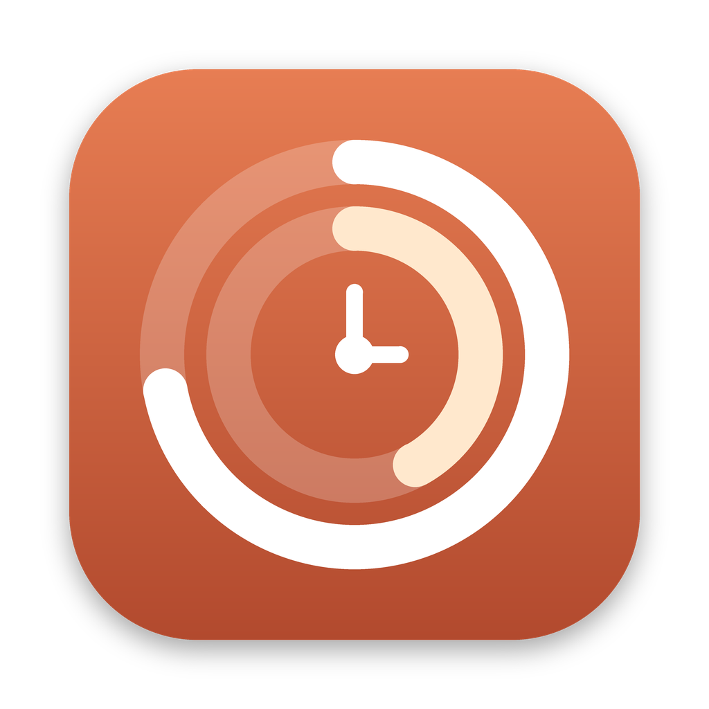

<p align="center"></p>

# ClaudeUsageBar für macOS

Eine schlanke **macOS-Menüleisten-App**, die live anzeigt, wie viel von deinem **Claude-5-Stunden-Limit** und deinem **Wochenlimit** schon verbraucht ist – und wann beides zurückgesetzt wird.

<p align="center">
  <picture>
    <source media="(prefers-color-scheme: light)" srcset="docs/screenshot-light.png">
    
  </picture>
</p>

Alles Wichtige steht direkt in der Menüleiste, ohne Klick:

```
5h 42% ↻14:00 │ W 18% ↻Mo 09:00
```

= 42 % vom 5-Stunden-Limit verbraucht, Reset heute um 14:00 · 18 % vom Wochenlimit, Reset Montag 09:00.

Ein Klick öffnet ein Panel mit:

- 🟢🟠🔴 Fortschrittsbalken für das **5-Stunden-Fenster** und das **Wochenlimit**
- ⏱ Genauer Reset-Zeitpunkt plus Countdown, z. B. `Reset heute um 14:00 Uhr · in 1 Std 29 Min` oder `Reset Montag, 23.11. um 09:00 Uhr · in 1 T 20 Std 29 Min`
- Eigene Wochen-Zeilen für **Opus** / **Sonnet**, sofern dein Plan sie hat
- Automatisches Backoff bei Rate-Limit (HTTP 429)
- Manuelles Aktualisieren, Intervall-Auswahl (Standard 2 min), Reset-Uhrzeit in der Menüleiste an/aus, Autostart bei Anmeldung

Kein Dock-Icon, kein Fenster – nur die Menüleiste.

---

## Voraussetzungen

| | |
|---|---|
| **macOS** | 13 Ventura oder neuer (Apple Silicon & Intel) |
| **Toolchain** | Xcode *oder* nur die Command Line Tools (`xcode-select --install`) |
| **Account** | Claude Pro / Max – am einfachsten mit eingeloggtem [Claude Code](https://docs.claude.com/en/docs/claude-code) |

## Installation

```bash
git clone https://github.com/xamtodd/ClaudeUsageBar.git
cd ClaudeUsageBar
./build.sh
```

`build.sh` kompiliert per Swift Package Manager im Release-Modus, baut daraus `ClaudeUsageBar.app`, signiert sie ad-hoc, kopiert sie nach `~/Applications` und startet sie.

Beim ersten Start fragt macOS, ob die App auf den Schlüsselbund-Eintrag **„Claude Code-credentials“** zugreifen darf → **Immer erlauben**.

### Autostart

Panel öffnen → **Einstellungen** → **Bei Anmeldung starten**.
(Nutzt `SMAppService`; erscheint danach unter *Systemeinstellungen → Allgemein → Anmeldeobjekte*.)

### Update

```bash
git pull && ./build.sh
```

### Deinstallieren

```bash
pkill -x ClaudeUsageBar; rm -rf ~/Applications/ClaudeUsageBar.app
defaults delete de.maxgerbeth.ClaudeUsageBar
```

## Woher kommen die Daten?

Die App probiert zwei Quellen, in dieser Reihenfolge:

1. **Claude Code (empfohlen, null Konfiguration)**
   Liest den OAuth-Token, den Claude Code im macOS-Schlüsselbund (`Claude Code-credentials`) bzw. in `~/.claude/.credentials.json` ablegt, und fragt damit `https://api.anthropic.com/api/oauth/usage` ab.
   → Einmal `claude` starten und `/login` ausführen genügt.

2. **claude.ai sessionKey (Fallback)**
   Ohne Claude Code: im Browser auf claude.ai einloggen → DevTools → *Application/Storage* → *Cookies* → Wert von `sessionKey` kopieren → im Panel unter **Einstellungen** einfügen und Enter drücken.

Der Token verlässt deinen Mac nicht – er wird nur an die Anthropic-/claude.ai-Endpunkte geschickt.

## Troubleshooting

| Anzeige | Lösung |
|---|---|
| `Claude ⚠︎` + „Keine Zugangsdaten“ | In Claude Code einloggen (`claude` → `/login`) oder sessionKey eintragen |
| „Token abgelaufen“ | Einmal `claude` im Terminal starten – Claude Code erneuert den Token. Die App refresht bewusst **nicht** selbst, sonst würde Claude Code ausgeloggt. |
| „Nicht autorisiert“ | Neu einloggen bzw. frischen sessionKey eintragen |
| „Rate-Limit erreicht“ | Die App wartet automatisch länger. Intervall ggf. auf 2–5 min stellen. |
| „App kann nicht geöffnet werden“ | Rechtsklick auf die App → *Öffnen*, oder `xattr -dr com.apple.quarantine ~/Applications/ClaudeUsageBar.app` |
| Build-Fehler `swift: command not found` | `xcode-select --install` |

## README-Screenshots neu erzeugen

```bash
swift build -c release && .build/release/ClaudeUsageBar --screenshot docs
```

Rendert `docs/screenshot.png` (dunkel) und `docs/screenshot-light.png` (hell) mit deinen aktuellen Werten.

## Projektstruktur

```
ClaudeUsageBar/
├── Package.swift                     # SwiftPM, macOS 13+
├── Info.plist                        # LSUIElement = true (kein Dock-Icon)
├── build.sh                          # bauen, Icon erzeugen, signieren, installieren, starten
├── Resources/AppIcon.png             # App-Icon (1024 px)
└── Sources/ClaudeUsageBar/
    ├── App.swift                     # MenuBarExtra, ViewModel, Panel-UI
    ├── UsageService.swift            # Token lesen, API-Abruf, JSON-Modell
    └── Screenshot.swift              # --screenshot <ordner>: README-Bilder mit echten Daten rendern
```

## Hinweis

Inoffizielles Hobbyprojekt, nicht von Anthropic. Die genutzten Usage-Endpunkte sind nicht öffentlich dokumentiert und können sich jederzeit ändern.
