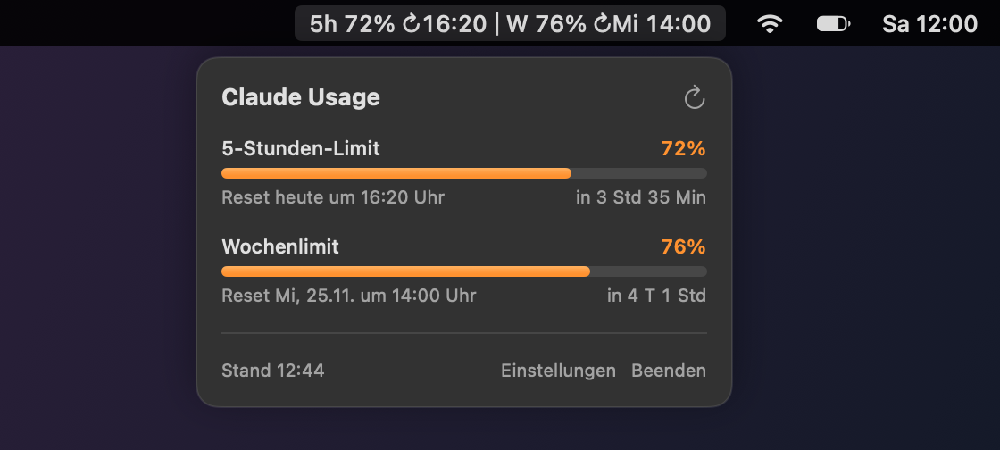
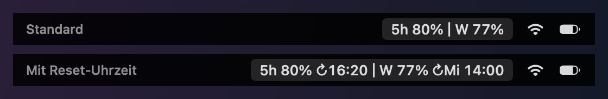

<p align="center"></p>

# ClaudeUsageBar for macOS

A lightweight **macOS menu bar app** that shows, live, how much of your **Claude 5-hour limit** and your **weekly limit** you have used, and when each one resets.



The menu bar shows a compact summary:

```
5h 42% │ W 18%
```

That means 42 % of the 5-hour limit and 18 % of the weekly limit are used.

### Extended view: reset time in the menu bar

If you want to see at a glance **when** the 5-hour window and the weekly limit reset, turn on the extended view under **Settings → *Reset-Uhrzeit in der Menüleiste*** (reset time in the menu bar):

```
5h 42% ↻14:00 │ W 18% ↻Mo 09:00
```



Clicking it opens a panel with:

- 🟢🟠🔴 Progress bars for the **5-hour window** and the **weekly limit**
- ⏱ The exact reset time plus a countdown, e.g. `Reset heute um 14:00 Uhr · in 1 Std 29 Min` (today at 14:00, in 1 h 29 min)
- Separate weekly rows for **Opus** / **Sonnet** if your plan has them
- **Token breakdown (Claude Code)**: a collapsible section with the tokens used in the current 5-hour window or this week, headline number is input + output (cache reads are cheap and would inflate it), with a breakdown into input, output, cache read and cache write, plus per-model totals and your top projects. Read locally from Claude Code's logs in `~/.claude/projects`; claude.ai chats are not included.
- Automatic backoff on rate limits (HTTP 429)
- Manual refresh, refresh interval (1–5 min, default 2 min), reset time in the menu bar on/off (default: off), launch at login

No Dock icon, no window, just the menu bar. The app's interface is in German.

---

## Requirements

| | |
|---|---|
| **macOS** | 13 Ventura or later (Apple Silicon & Intel) |
| **Toolchain** | Xcode *or* just the Command Line Tools (`xcode-select --install`) |
| **Account** | Claude Pro / Max, easiest with [Claude Code](https://docs.claude.com/en/docs/claude-code) logged in |

## Installation

```bash
git clone https://github.com/xamtodd/ClaudeUsageBar-for-Mac.git
cd ClaudeUsageBar-for-Mac
./build.sh
```

`build.sh` compiles a release build with Swift Package Manager, packages it as `ClaudeUsageBar.app`, signs it ad hoc, copies it to `~/Applications` and launches it.

On first launch, macOS asks whether the app may access the keychain item **"Claude Code-credentials"**. Choose **Always Allow**.

### Launch at login

Open the panel → **Einstellungen** (Settings) → **Bei Anmeldung starten** (launch at login).
(Uses `SMAppService`; the app then appears under *System Settings → General → Login Items*.)

### Update

```bash
git pull && ./build.sh
```

### Uninstall

```bash
pkill -x ClaudeUsageBar; rm -rf ~/Applications/ClaudeUsageBar.app
defaults delete de.maxgerbeth.ClaudeUsageBar
```

## Where does the data come from?

The app tries two sources, in this order:

1. **Claude Code (recommended, zero configuration)**
   Reads the OAuth token that Claude Code stores in the macOS keychain (`Claude Code-credentials`) or in `~/.claude/.credentials.json`, and uses it to query `https://api.anthropic.com/api/oauth/usage`.
   → Running `claude` once and doing `/login` is all it takes.

2. **claude.ai sessionKey (fallback)**
   Without Claude Code: log in to claude.ai in your browser → DevTools → *Application/Storage* → *Cookies* → copy the value of `sessionKey` → paste it in the panel under **Einstellungen** (Settings) and press Enter.

Your token never leaves your Mac except to be sent to the Anthropic / claude.ai endpoints. A sessionKey you enter is stored in your macOS keychain, not in plain text. Requests use an ephemeral session, so no claude.ai cookies or responses are cached on disk.

## Troubleshooting

| What you see | Fix |
|---|---|
| `Claude ⚠︎` + "Keine Zugangsdaten" (no credentials) | Log in to Claude Code (`claude` → `/login`) or enter a sessionKey |
| "Token abgelaufen" (token expired) | Run `claude` once in the terminal; Claude Code renews the token. The app deliberately does **not** refresh it itself, because that would log Claude Code out. |
| "Nicht autorisiert" (unauthorized) | Log in again or enter a fresh sessionKey |
| "Rate-Limit erreicht" (rate limit reached) | The app automatically waits longer. Consider setting the interval to 2–5 min. |
| "App can't be opened" | Right-click the app → *Open*, or `xattr -dr com.apple.quarantine ~/Applications/ClaudeUsageBar.app` |
| Build error `swift: command not found` | `xcode-select --install` |

## Project structure

```
ClaudeUsageBar/
├── Package.swift          # SwiftPM, macOS 13+
├── Info.plist             # LSUIElement = true (no Dock icon)
├── build.sh               # build, create icon, sign, install, launch
├── docs/                  # README screenshots
├── Resources/AppIcon.png  # app icon (1024 px)
└── src/
    ├── App.swift          # MenuBarExtra, view model, panel UI
    ├── UsageService.swift # token lookup, API request, JSON model, keychain storage
    └── TokenStats.swift   # incremental scan of Claude Code logs for token counts
```

## Disclaimer

Unofficial hobby project, not affiliated with Anthropic. The usage endpoints it relies on are not publicly documented and may change at any time.

The code contains **no** keys or tokens: everyone automatically uses their own Claude Code credentials from their own keychain.

## License

[MIT](LICENSE)
